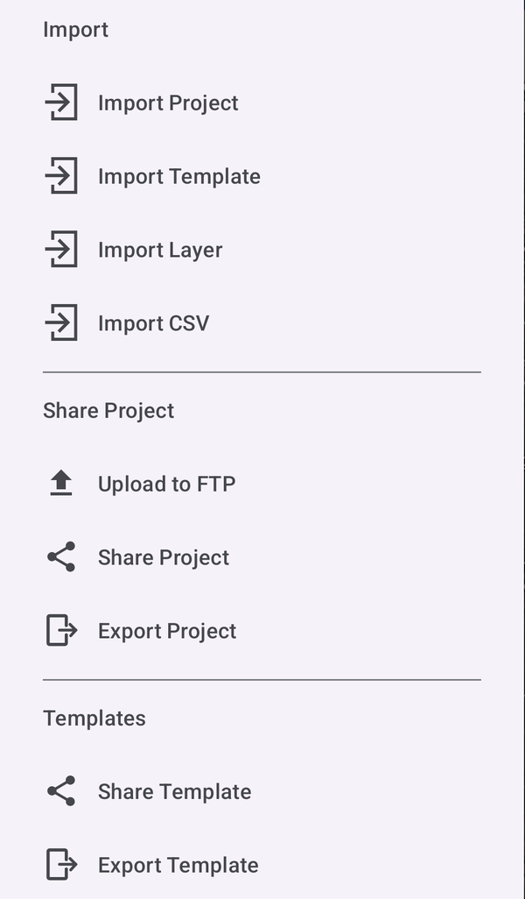
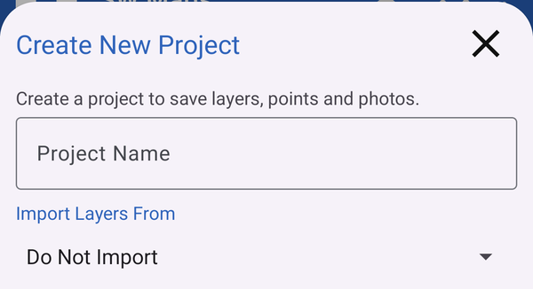
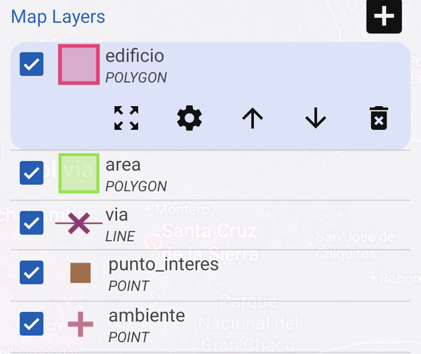
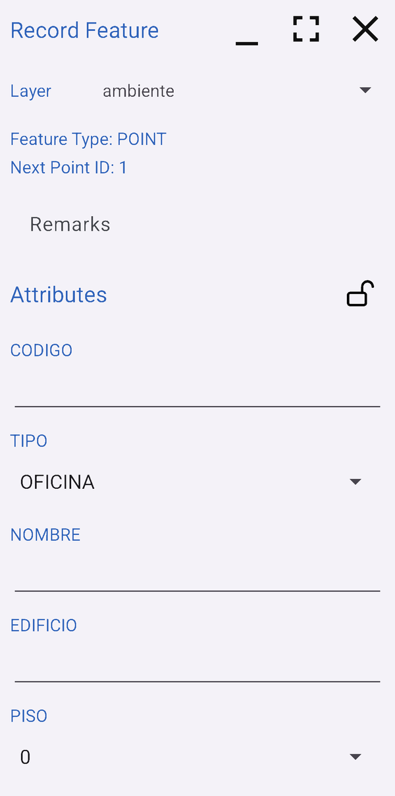

# Guía de campo — Rectorado (2)

> Se lee en 5 minutos. Qué le toca a cada uno está en el [Reparto de tareas](reparto-tareas.md).
> Ante cualquier duda, pregunten en el grupo.

## Cuándo

| Día | Qué |
|---|---|
| **Viernes 27** | **Interior** del Edificio Administrativo (las oficinas tienen que estar abiertas) |
| **Sábado 28** | **Exterior**: entradas, extintores, baños y senderos |
| **Lunes 30** | Completar lo que haya faltado |

## 1. Antes de salir (en casa)

1. Instalar **SW Maps** desde la Play Store (de *SoftWel*). Aceptar los permisos de ubicación **precisa**, cámara y archivos.
2. Descargar el archivo `RECT2_Campo_v1.swmr` que Luis manda al grupo de WhatsApp.
3. En SW Maps: menú (☰) → **Import Template** → elegir ese archivo.
4. Menú → **Projects** → **+**. Ponerle el nombre propio (ej. `RECT2_Cristian`) y en **Import Layers From** elegir la plantilla `RECT2_Campo_v1`.
5. Menú → **Settings** → activar **Keep Screen On**.

 

Si todo salió bien, en el botón de capas aparecen estas 5:

**Qué llevar:** el celular cargado (y power bank si tienen), datos móviles para el mapa satelital, una hoja y un lápiz para el croquis y el carnet universitario.

## 2. Qué capa usar

| Lo que encuentras | Capa | TIPO |
|---|---|---|
| Oficina, secretaría, caja | `ambiente` | OFICINA, SECRETARIA, CAJA |
| Entrada, rampa, gradas | `punto_interes` | ENTRADA, RAMPA, GRADAS |
| Extintor, botiquín, salida de emergencia | `punto_interes` | EXTINTOR, BOTIQUIN, SALIDA_EMERGENCIA |
| Baño, bebedero | `punto_interes` | SANITARIO, BEBEDERO |
| Sendero, acera, pasillo techado | `via` | SENDERO, ACERA, PASILLO_TECHADO |

**Canchas, jardines, parqueos y edificios: no se dibujan.** Solo foto y lo que se ve (pisos, si hay ascensor, de qué es el piso de la cancha). El contorno lo dibujan Luis y Karen en ArcMap.

## 3. Registrar un punto

1. Pararse **en la puerta** del lugar. No en medio del pasillo ni dentro de la oficina.
2. Tocar **REC** (arriba) → **Record Feature**.
3. En **Layer**, elegir la capa (ver la tabla del paso 2).
4. Llenar los campos:
    - **TIPO**: de la lista.
    - **PISO**: `0` = planta baja, `1` = primer piso, `2` = segundo.
    - **NOMBRE**: como dice el letrero.
    - **EDIFICIO**: `CAMPUS-ADM` si es el Edificio Administrativo.
    - **CODIGO**: solo si está en la lista del paso 5. Si no, vacío.
    - **REFERENCIA**: cómo llegar. Ej.: *"subiendo la escalera, segunda puerta a la izquierda"*.
5. Tomar la **foto** (FOTO_PTA: la puerta con el letrero visible).
6. Marcar **Averaging**, esperar unos 10 segundos y tocar el **pin** (abajo a la derecha) para guardar.

> ⚠ **TIPO viene con OFICINA y PISO con 0 por defecto.** Hay que revisar los dos en cada punto. Es el error más común.

 

Lo que hay que anotar de cada cosa (extintores, baños, entradas…) está en la tabla [Qué anotar de cada cosa](reparto-tareas.md#qué-anotar-de-cada-cosa).

## 4. Registrar un sendero

1. REC → **Record Feature** → capa `via`.
2. Caminar por el sendero y agregar un punto **en cada curva**.
3. Al llegar a un **cruce** con otro sendero, terminar la línea ahí y empezar otra nueva. Así se arman las rutas de la app.
4. Cada línea tiene que llegar hasta una **entrada** del edificio.

Recorrido: desde la entrada del Campus hasta el Edificio Administrativo, y alrededor del edificio.

## 5. En cada oficina

Saludar y explicar: *"Somos estudiantes de Informática, materia SIG. Estamos haciendo el mapa de las oficinas de la U. ¿Nos puede dar un par de datos?"*

Preguntar y anotar: nombre exacto y sigla, responsable y cargo, horario de atención, teléfono o interno, qué trámites o servicios hace y de qué unidad depende.

**Croquis:** por cada piso, dibujar en una hoja el pasillo y el orden de las oficinas, con su nombre, y sacarle foto. Con eso se ubican en el mapa, porque adentro el GPS falla.

**Códigos de las oficinas conocidas:**

| CODIGO | Oficina |
|---|---|
| `CAMPUS-ADM-DAEF` | Dirección Administrativa Económica y Financiera |
| `CAMPUS-ADM-AF` | Activo Fijo |
| `CAMPUS-ADM-CC` | Compras y Contrataciones |
| `CAMPUS-ADM-IEU` | Infraestructura y Equipamiento |
| `CAMPUS-ADM-MMU` | Mantenimiento y Mejoramiento |
| `CAMPUS-ADM-PRES` | Presupuesto |
| `CAMPUS-ADM-AUD` | Auditoría Interna |
| `CAMPUS-ADM-DH` | Desarrollo Humano (RR.HH.) |

¿Otra oficina en el edificio? Registrarla igual, con CODIGO vacío. ¿Una de la lista está en otro edificio? Anotar dónde y avisar en el grupo.

## 6. Al terminar el día

1. Menú (☰) → **Share Project** → mandarlo a Luis por WhatsApp.
2. Mandar también las fotos de los croquis y las notas.
3. **No borrar** el proyecto del celular hasta que Luis confirme que le llegó.

## Fotos

- Con el celular **horizontal** y el letrero legible.
- La fachada del edificio desde lejos, que se vea entera.
- Sin personas de frente. Si hay gente, esperar o cambiar el ángulo.
